<div align="center">

[![Regex For Humans: a regex ^#[0-9A-Fa-f]{6}$ com o significado de cada fragmento em inglês simples logo abaixo](https://raw.githubusercontent.com/OthmaneBlial/Regex-For-Humans/main/site/assets/readme-banner.svg)](https://othmaneblial.github.io/Regex-For-Humans/)

**Escreva regex em inglês simples. Leia qualquer regex do mesmo jeito.**

Regras curtas em inglês viram um `RegExp` nativo de JavaScript, com um fragmento visível por regra. Cole uma regex e receba as regras de volta.

**[Experimentar a oficina](https://othmaneblial.github.io/Regex-For-Humans/workshop/) · [Site](https://othmaneblial.github.io/Regex-For-Humans/) · [Prévia no npm](https://www.npmjs.com/package/regex-for-humans/v/0.1.0-dev.13) · [Sintaxe](../LANGUAGE.md)**

[English](../../README.md) · [简体中文](README.zh-CN.md) · [Español](README.es.md) · [Français](README.fr.md) · **Português do Brasil** · [日本語](README.ja.md) · [Deutsch](README.de.md) · [हिन्दी](README.hi.md) · [العربية](README.ar.md) · [اردو](README.ur.md)

</div>

## Escreva regras, receba uma regex

<table>
<tr><th>Regras</th><th>Regex JavaScript</th></tr>
<tr><td>

```text
start "#"
6 hex digits
end
```

</td><td>

```js
/^#[0-9A-Fa-f]{6}$/u
```

✅ `#12aBcF` · `#000000`<br>
❌ `#123` · `#G00000`

</td></tr>
</table>

Cada linha tem um significado documentado e acrescenta um fragmento à regex, em ordem. O resultado é a regex que você escreveria à mão: `?` em vez de `{0,1}`, sem grupos sobrando. Uma frase desconhecida para com sua linha, coluna e uma correção sugerida.

[](https://othmaneblial.github.io/Regex-For-Humans/workshop/)

## Leia uma regex de volta

Herdou um padrão que ninguém consegue ler? `regexToRules` transforma uma regex compatível em regras editáveis, que compilam de volta para a mesma regex.

```js
import { regexToRules } from 'regex-for-humans';

regexToRules(/^[A-Z]{2}-\d{4}$/u).rules;
```

```text
start
2 uppercase letter
"-"
4 digit
end
```

O [site](https://othmaneblial.github.io/Regex-For-Humans/) anota no lugar qualquer regex colada. Sintaxe sem suporte é recusada com sua posição, nunca descartada em silêncio.

## Dê nome ao que você captura

<!-- captures:date -->
```text
start
capture "year" {
  4 digits
}
"-"
capture "month" {
  2 digits
}
"-"
capture "day" {
  2 digits
}
end
```

```js
toRegExp(compile(rules)).exec('2026-10-10').groups;
// { year: '2026', month: '10', day: '10' }
```

Capturas são grupos nativos de JavaScript. Escreva `same as capture "year"` para exigir o mesmo texto de novo.

## Instalação

```sh
npm install regex-for-humans@preview
```

```js
import { compile, toRegExp } from 'regex-for-humans';

const result = compile('start\n3 digits\nend');
console.log(result.source);                 // ^\d{3}$
console.log(toRegExp(result).test('123'));  // true
```

```sh
printf 'start "ABC"\n3 digits\nend\n' | npx --yes --package=regex-for-humans@preview regex-for-humans --explain
```

Node.js 22+, sem dependências em tempo de execução, ESM com declarações TypeScript. A biblioteca, a [linha de comando](../CLI.md) e a oficina usam o mesmo compilador. É uma prévia (`0.1.0-dev.13`); a [oficina](https://othmaneblial.github.io/Regex-For-Humans/workshop/) não precisa de instalação.

## O vocabulário num relance

| Escreva | Receba |
| --- | --- |
| `start` · `end` | `^` · `$` |
| `3 digits` · `digits` | `\d{3}` · `\d+` |
| `between 2 and 4 letters` | `[A-Za-z]{2,4}` |
| `optional "-"` | `-?` |
| `one of: a, b` | `[ab]` |
| `either { "INFO" "WARN" }` | `(?:INFO\|WARN)` |
| `capture "id" { … }` | `(?<id>…)` |
| `not followed by { "x" }` | `(?!x)` |

Blocos como `either { … }` têm uma regra por linha dentro das chaves. O [guia da linguagem](../LANGUAGE.md) cobre cada regra, flag, classe Unicode, asserção e limite.

## 34 receitas prontas para abrir

| Receita | O que verifica |
| --- | --- |
| [Validar uma data do calendário](https://othmaneblial.github.io/Regex-For-Humans/workshop/?example=calendar-date) | Mês 01–12, dia 01–31, capturados como ano, mês e dia |
| [Validar um endereço IPv4](https://othmaneblial.github.io/Regex-For-Humans/workshop/?example=ipv4-address) | Quatro números de 0 a 255, sem zeros à esquerda |
| [Validar um horário de 24 horas](https://othmaneblial.github.io/Regex-For-Humans/workshop/?example=clock-time) | De `00:00` a `23:59` |
| [Validar a sintaxe SemVer 2.0](https://othmaneblial.github.io/Regex-For-Humans/workshop/?example=semantic-version) | Núcleo, pré-lançamento e metadados de build |
| [Extrair campos nomeados de um log](https://othmaneblial.github.io/Regex-For-Humans/workshop/?example=log-fields) | Nível e código, pelo nome |
| [Encontrar uma palavra repetida](https://othmaneblial.github.io/Regex-For-Humans/workshop/?example=repeated-word) | Uma palavra e depois a mesma palavra |

Cada receita traz exemplos que devem e não devem casar, e uma nota sobre o que ela não verifica. Veja [as 34 receitas](../RECIPES.md) e quatro [exemplos complexos](../COMPLEX-EXAMPLES.md) com **35 casos aceitos ou recusados**.

## Por que confiar no resultado

- **Determinístico.** Um analisador, não um modelo: as mesmas regras sempre geram a mesma regex. Sem IA, sem rede, sem telemetria.
- **Nativo.** O resultado é um `RegExp` comum; na hora de casar, só o motor roda. As [exportações](../LANGUAGE.md#engine-exports) para Python, Rust, Go, Java, C#, PHP e Ruby são comparadas com esses motores.
- **Honesto sobre os limites.** As receitas dizem o que não verificam. A oficina testa seus exemplos num worker com tempo limitado; uma regex copiada precisa das próprias proteções ([modelo de segurança](../SECURITY_MODEL.md)).
- **Testado.** Cada receita e cada exemplo deste README são recompilados pela suíte de testes ([testes](../TESTING.md)).

[Arquitetura](../ARCHITECTURE.md) · [Compatibilidade](../COMPATIBILITY.md) · [Contribuir](https://github.com/OthmaneBlial/Regex-For-Humans/blob/main/CONTRIBUTING.md) · [Mudanças](../../CHANGELOG.md) · [Segurança](../../SECURITY.md) · [MIT](../../LICENSE)

<div align="center">

Se uma regra daqui poupou você de apertar os olhos, uma ⭐ ajuda outros desenvolvedores a encontrar o projeto.

</div>
